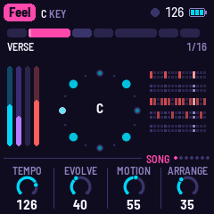
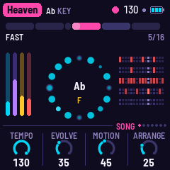
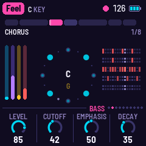

# MOR-1 for the M-VAVE FM-1

MOR-1 turns the M-VAVE FM-1 into a generative electronic disco machine, after Giorgio Moroder's Munich sound. It
plays itself from the moment it's switched on: a Moog-style bass sequence out in front, its repeats on the other
side; strings, a choir or detuned saws through a phaser; a synth lead (ten voices) that writes its
own phrases, which you can play from the white keys and which answers you; four on the floor with claps, open hats and syndrum fills. Each song is a form (intro, verse, chorus,
break) with its own chord changes, and it loops for ever, changing as it goes: a section repeated, a layer let
out for a while, the whole song moved up a key for a cycle. You steer it: pick a song, a key, a bass pattern,
hold a section, push it on to the next.

  

**Status: beta, simulator only.** It runs in fm1-base's simulator and passes its tests; it has not yet been built
for or run on an FM-1. See [BUILDING.md](BUILDING.md) for the toolchain.

## The presets

Nine presets, each with its own tempo, key, chord changes and arrangement. The lines are MOR-1's own, written as
it plays.

| # | Preset | BPM | Key |
|---|---|---|---|
| 1 | Feel | 126 | C |
| 2 | Gio | 113 | A minor |
| 3 | Mutant | 123 | F minor |
| 4 | Heaven | 130 | A♭ |
| 5 | TickTock | 126 | C, then E♭ |
| 6 | Energy | 123 | C minor |
| 7 | Fly | 126 | A minor |
| 8 | Lover | 130 | C minor |
| 9 | Express | 128 | D minor |

All of it is a table in `app/dsp/mor.c` (`SONGS`), easy to change.

## In short

| | |
|---|---|
| White keys | The lead, in the song's scale (the chord's notes lit); a call of three notes and a pause, and the lead answers and takes it as its theme |
| Black keys | Eleven drop-in effects, each while held |
| FX | The Effects page: sixteen effects on the white keys (REC held: the same, while held); again: the Space page |
| PLAY · REC · EDIT | Play / stop · a tap holds the section · the next section, on the next bar |
| HOME · ENV · ARP · LFO · SEQ · FX · GLO | The pages: Song, Bass, Lead (again: Lead FX), Pad, Drums, Effects (again: Space), Setup (again: MIDI); KNOB 1–4 set their values |
| SELECT | The previous or next page; with HOME held, the tempo (110–130) |
| ALGORITHM · PRESETS | The bass pattern · the song |
| OCT− / OCT+ | The bass's octave |
| SAVE | Saves; held, puts the song back to its recipe |

Hold any button for a second and a card says what it does. The [manual](docs/MANUAL.md) has the rest.

## Building and testing

MOR-1 is an app on [fm1-base](https://github.com/charlesvestal/fm1-base) (`base/`, a git submodule); clone with
`--recursive`. The toolchain and prerequisites are in [BUILDING.md](BUILDING.md):

```
sh tests/run_tests.sh                                  # the instrument, the app in the simulator
./build.sh --host                                      # the simulator: app/build/host/mor_host
./build.sh                                             # app/build/mor.fwsc (needs JieLi's toolchain and SDK)
python3 base/tools/fm1_install.py app/build/mor.fwsc   # install it over USB
```

`app/build/host/mor_host SCRIPT OUTDIR` runs the whole app on a computer from a script (`tests/scenarios/*.mor`),
with audio and screenshots coming out. `tests/host/mor_render.c` renders one song's engine alone to a WAV, with
its sections, levels and the engine's time:

```
cc -O2 -ffp-contract=off -DEN_HOST -Iapp/dsp -Ibase/include -o mor_render tests/host/mor_render.c app/dsp/mor.c -lm
./mor_render 3 180 heaven.wav          # song 4, three minutes
CHORDS=1 ./mor_render 4 120 clock.wav  # with every chord change printed
```

## Credits

A fork of [AMB-1](https://github.com/charlesvestal/fm1-amb) by Charles Vestal, whose platform, panel, plate reverb
and tape echo it keeps. The idea of a song form that loops and changes is [DUB-1](https://github.com/sbegueria/fm1-dub)'s
and [NACHTFAHRT](https://github.com/FartyPants/fm1-nachtfahrt)'s (no code from either). Built on
[fm1-base](https://github.com/charlesvestal/fm1-base) and [felucca-bsp](https://github.com/hugelton/felucca-bsp),
from [Felucca](https://github.com/hugelton/Felucca) by Leo Kuroshita (Hügelton Instruments). MPL-2.0; see
[LICENSING.md](LICENSING.md).

M-VAVE and FM-1 are trademarks of their owners. MOR-1 is not affiliated with M-VAVE, Giorgio Moroder, any artist
named here, or Hügelton Instruments.
