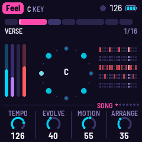
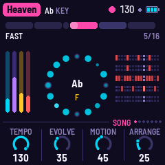
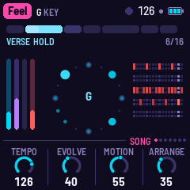
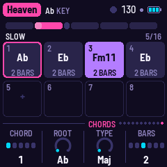
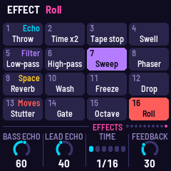

# GIO-1

GIO-1 turns the M-VAVE FM-1 into a generative electronic disco machine, after Giorgio Moroder's Munich sound. It
plays itself from the moment it's switched on: a Moog-style bass sequence out in front, a pad of strings, a choir
or saws through a phaser, a synth lead that writes its own phrases, and four on the floor. Each song is a form of
sections with their own chord changes; it loops for ever and changes as it goes. You steer it.

> **Status: alpha, under further testing.** GIO-1 0.1-alpha has been installed on only one FM-1 so far, where it
> works; it is still being tested. Installing it is at your own risk: unofficial firmware could brick an FM-1. The
> safety nets and the way back to M-VAVE's firmware are on the [Install page](https://guinanno1.github.io/fm1-gio/install/).

---

## Contents

1. Install
2. Getting started
3. Controls
4. The screen
5. The music
6. The presets
7. The pages
8. MIDI (and 8a. Effects)
9. Saving
10. Troubleshooting
11. Parameters
12. Credits

---

## 1. Install

GIO-1 has no release yet. Once it is built (`./build.sh`, see [BUILDING.md](../BUILDING.md)):

```
python3 base/tools/fm1_install.py app/build/gio.fwsc
```

with Python 3 and `pip3 install mido python-rtmidi`, the FM-1 on a USB data cable. Don't unplug it while it's
writing; when it finishes, the FM-1 restarts into GIO-1. fm1-base's web installer page (`tools/make_site.py`)
does the same from Chrome or Edge once a site is published.

**Go back:** the web installer's "Back to the stock firmware", or M-VAVE's own updater, M-UPGRADE, from
[m-vave.com/download](https://www.m-vave.com/download).

> Installing other firmware is at your own risk. If the FM-1 ever won't start, see Troubleshooting.

---

## 2. Getting started

1. Switch it on. The word **GIO** wipes in as a chord rises and lands with a star; a moment later GIO-1 plays the first
   song, **Feel**, from its intro. Touch any control to skip the start-up: the song starts when you let go.
2. Turn **PRESETS** for another song. It starts from the top of its form.
3. Play the **white keys**: the lead plays them, always in the song's scale. Play three notes or more and pause: the
   lead answers you, and takes your notes as its theme.
4. Hold a **black key**: an effect while you hold it (Throw, Tape stop, Sweep ...). Press **FX** for all sixteen.
5. Turn **ALGORITHM** for another bass pattern; back to **Song** for the song's own.
6. Press **SEL** to move on to the next section on the next bar; press **REC** to stay in this one.
7. Press **EDIT** to see the section's chords, and change them: KNOB 1 picks a chord, KNOB 2–4 set its root, type
   and length.
8. Press **ENV** for the Bass page and turn KNOB 2: the cutoff opens.

---

## 3. Controls

| Control | What it does |
|---|---|
| White keys | The lead: each key a step of the song's scale, from its key note up. The keys of the chord playing are lit (the safest notes). Three notes or more and a pause of two beats: the lead answers (see The lead, below). On the Effects page: the sixteen effects. |
| Black keys | Eleven effects, each while its key is held, left to right: Throw, Tape stop, Swell, Low-pass, High-pass, Sweep, Phaser, Freeze, Drop, Stutter, Roll. Lit; dark while held. |
| FX | The Effects page (see Effects); again: the Bass FX, Pad FX, Lead FX and Drums FX pages, one a press, then the Space page, then round again. |
| PLAY | Plays / stops. From stopped, the song starts from its first section. |
| REC | A tap: HOLD, the section repeats until you tap it again. Held: the effects grid on the white keys for as long as it's held. |
| EDIT | The Chords page (see [The Chords page](#the-chords-page)). |
| SEL | The next section, on the next bar. |
| OCT− / OCT+ | The bass an octave down / up (−1 to +1). |
| ALGORITHM | The bass pattern: Song (the song's own, section by section), Pump, Pump 16, Arpeggio, Gallop, Octaves, Slow. |
| PRESETS | The song. Each remembers its settings as you left it. |
| HOME, ENV, ARP, LFO, SEQ, FX, GLO | The pages: Song, Bass, Lead, Pad, Drums, Effects, Setup. HOME again: Mixer; ARP again: Lead 2; FX again: the four FX pages, then Space; GLO again: MIDI. Each press goes on to the button's next page, then round again. |
| SELECT | The previous / next page. With HOME held: the tempo, 110 to 130. |
| KNOB 1–4 | The page's four values. A quick turn speeds up; a slow one goes a step at a time. |
| SAVE | Saves all the songs. Held 1.5 s: the song back to its recipe (then SAVE to keep that). |
| MASTER | The volume. |

Hold any button for a second and a card says what it does; let go and nothing else happens.

---

## 4. The screen



- **The top line:** the song in a magenta tag, its key; on the right a beat light (a play triangle while stopped),
  the tempo, a dot while something isn't saved, and the battery. Messages show here for a moment.
- **The form:** a block for each section, as wide as its bars. The one playing is lit, filling as it goes; the one
  coming next is a shade brighter than the rest. While held, it turns ice blue. Under it: the section's name and the bar (3/16).
- **The ring:** the bass pattern's sixteen steps, the first at the top. A step's size and brightness is how high its
  note is; a ring around it is an accent; small dots are rests. The step playing is bright. In the middle, the chord,
  and under it the lead's note as it plays.
- **The meters** (left): bass, pad, lead, drums. A dark track means the layer is out of this section.
- **The drums** (right): kick, snare, closed hat, open hat, tom; this bar's hits, the step playing bright.
- **The knobs:** the page's four values; the one being turned is lit.

| | |
|---|---|
|  |  |

---

## 5. The music

**The bass** is the loudest thing: two saws and a square an octave down through a four-pole ladder low-pass, a
short decay on its level and its filter (Cutoff, Emphasis and Decay on the Bass page). It steps through a 16-step
pattern written in chord degrees (root, third, fifth, seventh, octave), so it follows the chords. Most of the echo is
its own: the dry note sits a little left, its repeat right. With **Evolve**, a weak step changes
now and then (another chord note, a ghost note, a rest), and goes back home a step at a time.

**The pad** holds the chord on four voices, each moving as little as it can from chord to chord: **Strings** (two
saws), a **Choir** (a soft wave through two vowel formants, which **Bright** opens) or **Saws** (wider, swept). Then a
low-pass and a stereo **phaser** (four stages a side, swept slowly in quadrature, fed back).

**The lead** writes a four-bar phrase for each section it plays in: a motif, the motif answered, a second motif, the
first again; or, when **Busy** is low, a call and room for an answer. Its notes walk the song's scale, landing on the
chord on the strong beats, never a semitone off it. With **Evolve**, a note moves or the middle bar is rewritten at
each repeat. **Glide** slides between notes; past 60 it also swoops up into a phrase.

Ten voices: **Mini** (three saws, one an octave down, through a ladder filter), **Odyssey** (a saw and a narrow pulse,
resonant), **Synthi** (a triangle and a square, drifting), **Flute** (a sine with breath), **Theremin** (a sine, always
gliding, its vibrato wide), **FM Lead**, **FM Brass** and **FM Reed** (two-operator FM), **Choir** (two saws through three
vowel resonances; Tone is the vowel) and **Robot** (a square through two formants, short notes, no vibrato). The Lead 2
page (ARP again) has the lead's own **Echo** and **Reverb** sends, its **Octave** and its **Tone**.

**Playing the lead.** The white keys play it: each key a step of the song's scale from its key note up, so every note
fits. While you play, the lead's own phrases wait. Play three notes or more and pause for two beats: what you played
was a call, and the lead **answers** it a beat or two later in your rhythm, with notes of its own close to yours,
ending on the chord's root or fifth. From then on your notes are the song's **theme**: the lead plays them where it
plays, and grows the bars after them out of them (a third up, turned upside down, a third down), varied as it repeats
with Evolve. One or two notes are just played. A new song forgets the theme. Notes are counted on the grid to the
nearest sixteenth while the song plays.

**The drums**: a kick on every beat (on 1 and 3 in a half-time section), a snare-clap on 2 and 4, closed hats in
eighths or sixteenths (Hats), an open hat off the beat, and syndrum toms that fall in pitch. At the end of a section
there is often a fill (**Fills**: how often, and from 60 on, longer and with toms). A building section ends in a snare
roll. With **Evolve**, a syndrum or a ghost snare now and then.

**The form**: each song is a list of sections (Intro, Verse, Chorus, Break ...), each with its bars, its chord
changes, which layers play, a transposition and a few flags (half time, a build, a break). After the last section the
song goes back to a section of its own and goes round again. **Arrange** sets how freely it goes:

- a section may play twice;
- the song may jump to another section of its loop;
- a layer may sit a section out (the lead, the pad, the hats, the snare), or the lead come in where it wasn't;
- at the start of a cycle, the whole song may move up a tone, a semitone or a minor third (or down a tone) for a
  cycle, and come home after.

**Motion** is the slow sweep over minutes: the bass's filter opening and closing, the pad brightening, the phaser's
pace. A building section opens the bass filter as it goes; a break closes it and pushes the echo.

**The space**: a tape echo (two heads, the first at the echo's time on the right, the second at twice it on the left,
each repeat darker) and Dattorro's plate reverb.

---

## 6. The presets

Each preset has its own tempo, key, chord changes and arrangement. The bass lines, leads and drum parts are
GIO-1's own, written as it plays.

| # | Preset | BPM | Key | The form |
|---|---|---|---|---|
| 1 | Feel | 126 | C | Intro (bass, hats) · Verse (C) · Chorus (C–E♭–F–G) · Shift (on B♭) · Verse · Chorus · Break |
| 2 | Gio | 113 | A minor | Click (hats on the beat) · Arpeggio · Disco (Am–Em) · Strings (Am–F) · Fills · House |
| 3 | Mutant | 123 | F minor | Dawn (the pad alone) · Sequence · Groove · Theme (Fm–D♭) · Bridge (B♭m–Fm) · Theme |
| 4 | Heaven | 130 | A♭ | Slow ×2 (half time, A♭–E♭–Fm11–E♭) · Lift · Fast (A♭–E♭–B♭–A♭) · Vamp (Fm11) · Fast |
| 5 | TickTock | 126 | C, then E♭ | Intro · Verse (G–F) · Pre (Am–Dm–G–C) · Chorus (G–Em7–G) · Turn (C–E♭) · the same a minor third up · Outro |
| 6 | Energy | 123 | C minor | Intro · Groove (Cm) · Lift (A♭–B♭) · Groove (Cm–B♭) · Break · Build |
| 7 | Fly | 126 | A minor | Liftoff · Theme (Am–F–G) · Drift (Am–Dm) · Theme · Space |
| 8 | Lover | 130 | C minor | Intro · Verse (Cm–B♭) · Hook (A♭–B♭–Cm) · Robot · Hook |
| 9 | Express | 128 | D minor | Intro (the bass alone) · Drive · Strings · Theme (Dm–B♭–C) · Pursuit · Theme · Run |


---

## 7. The pages

| Page (button) | KNOB 1 | KNOB 2 | KNOB 3 | KNOB 4 |
|---|---|---|---|---|
| Song (HOME) | Tempo | Evolve | Motion | Arrange |
| Mixer (HOME again) | Bass | Pad | Lead | Drums |
| Bass (ENV) | Level | Cutoff | Emphasis | Decay |
| Lead (ARP) | Level | Voice | Busy | Glide |
| Lead 2 (ARP again) | Echo | Reverb | Octave | Tone |
| Pad (LFO) | Level | Colour | Bright | Phaser |
| Drums (SEQ) | Level | Fills | Hats | Swing |
| Bass FX (FX twice) | Echo | Reverb | Time | Feedback |
| Pad FX (FX 3 times) | Echo | Reverb | Time | Feedback |
| Lead FX (FX 4 times) | Echo | Reverb | Time | Feedback |
| Drums FX (FX 5 times) | Echo | Reverb | Time | Feedback |
| Space (FX 6 times) | Echo | Time | Feedback | Reverb |
| Setup (GLO) | Key | Tune | MIDI out | Lights |
| MIDI (GLO again) | MIDI out | Channels | Clock | Clock out |
| Effects (FX) | Bass echo | Lead echo | Time | Feedback |
| Chords (EDIT) | Chord | Root | Type | Bars |

The Setup page also shows the audio's load (CPU) in the top line.

### The Chords page



**EDIT** shows the chord changes of the section playing: the form across the top, as on the Song page, then up to
eight chords in two rows, each with its length. The chord playing is lit violet; the one you're editing is outlined in
magenta. Changes are heard from the next beat.

| Knob | |
|---|---|
| KNOB 1 · Chord | which chord to edit (1–8). Past the last one, **New**: an empty slot marked +, where turning any other knob adds a chord (a copy of the last one) |
| KNOB 2 · Root | its root, any of the twelve notes (it goes round), shown in the key it is in now |
| KNOB 3 · Type | Maj, Min, 7, Maj7, Min7, Min11, Sus4, Power (root and fifth) |
| KNOB 4 · Bars | ½, 1, 2, 3, 4 or 8 bars. On the last chord (if it isn't the only one), **End** takes it away |

The chords loop for as long as the section lasts. The page follows the music: when the section changes, it shows the
new one's chords. To stay on one, press **REC** (hold) while you edit; **SEL** moves to the next section. Some
sections share their chords (a song's two verses, say): editing one changes both.

The chords are written relative to the song's key, so changing the key (the Setup page, or a MIDI note) moves them
with it. Each song keeps its own chords, saved with its settings; **SAVE held** puts them back to the song's own, with
everything else.

---

## 8. MIDI

The MIDI page (GLO, then GLO again): **MIDI out**, **Channels**, **Clock** and **Clock out**. They belong to the FM-1, not
to a song.

- **In** (USB and the TRS jack): a note on channel 1 moves the key. **Clock** says where MIDI clock is taken from:
  **Internal** (none: GIO-1 keeps its own time, the default), **USB** or **TRS**. From the port chosen, clock drives
  the grid (EXT in the top line); Start plays the song from the top, Stop stops, Continue goes on. With no clock
  coming in, GIO-1 keeps its own time.
- **Out** (USB, when MIDI out is on; the FM-1's TRS jack is an input only): **Channels** 1, 2, 3, 10 (the default)
  puts the bass on channel 1, the pad on 2, the lead on 3, the drums on 10; 4, 5, 6, 11 puts them on 4, 5, 6 and 11.
  The drums are General MIDI notes: 36 kick, 39 clap, 42 and 46 hats, 45 tom. **Clock out** sends MIDI clock (and
  start and stop) while GIO-1 keeps its own time.

The FM-1 also shows up on a computer as a USB audio input: GIO-1 can be recorded over the cable.

**Screen mirror:** GIO-1's screen and panel can be shown live on a computer, big, for playing in front of people or
for anyone who finds the 1.54-inch screen hard to read. Plug the FM-1 in with a USB cable, open the website's
**Mirror** page in Chrome or Edge, press **Connect** and allow MIDI. The page can also play the panel. It costs the
music nothing: GIO-1 sends its screen only while the page asks for it.

---

## 8a. Effects



Sixteen effects, each on while its key is held, eased in and out; any number together. **FX** opens the Effects
page, where the white keys play them (white key 1 is the lowest); **REC held** brings the same grid up for as long as
it's held, and a key still held when REC is let go keeps its effect until it's let go. Eleven of them are also on the
black keys at all times. The page's knobs are the echo's: Bass echo, Lead echo, Time, Feedback.

**The Mixer** (HOME again): the four instruments' levels side by side, KNOB 1–4 Bass, Pad, Lead and Drums. They are
the same settings as each instrument's own page's Level, so a change shows on both.

**The FX pages.** FX again goes through a page for each instrument: **Bass FX**, **Pad FX**, **Lead FX** and **Drums FX**,
then **Space**, then back to the Effects page. On each, KNOB 1 **Echo** and KNOB 2 **Reverb** are how much of that
instrument goes into the tape echo and the plate; KNOB 3 **Time** and KNOB 4 **Feedback** are the echo's own. There is
one echo for all four, so Time and Feedback are the same on every page: turn them on one and the others follow. The
Space page's Reverb is the plate's overall level, over all four sends. Each song keeps its own settings; the songs
start with the pad out of the echo (Pad echo 0).

| Row | 1 | 2 | 3 | 4 |
|---|---|---|---|---|
| Echo (white 1–4) | **Throw**: everything into the echo | **Time x2**: the echo's time doubled, gliding there and back | **Tape stop**: the tape slowing to a quarter, the repeats diving | **Swell**: the echo fed back to the edge |
| Filter (5–8) | **Low-pass**: the mix down to 350 Hz | **High-pass**: the mix up to 1.3 kHz, thin | **Sweep**: the bass's filter open three octaves, Moroder's hand on the cutoff | **Phaser**: a deep phaser on everything |
| Space (9–12) | **Reverb**: everything into the plate | **Wash**: the dry down, everything into the echo and the plate | **Freeze**: the plate stops listening and rings on | **Drop**: everything out but the bass and the kick |
| Moves (13–16) | **Stutter**: a sixteenth of the mix caught and looped | **Gate**: the pad chopped in sixteenths | **Octave**: the bass an octave up | **Roll**: a snare every sixteenth, rising |

## 9. Saving

Each song keeps its settings as you left it. **SAVE** saves all of them; GIO-1 also saves by itself a few seconds
after a change while it is stopped (a save silences the sound for a moment, so never while playing). **SAVE held**
puts the song back to its recipe, its chords too. Tune and MIDI out belong to the FM-1, not to a song.

---

## 10. Troubleshooting

**Update mode:** hold OCT− and OCT+ together for five seconds. A countdown appears; let go before it ends to cancel.

**Calibration:** if a button or knob does the wrong thing, hold OCT− and OCT+ while you switch the FM-1 on, and follow
the screen.

**After a crash:** a red CRASH screen, then a restart a few seconds later; the next start shows RESTARTED AFTER A
CRASH and an address. If GIO-1 crashes twice in a row while starting, it starts in SAFE MODE: no sound, but USB
works, so the installer can reinstall it or put the stock firmware back. If even that fails, the FM-1 drops into
the chip's own update mode; fm1-base's rescue (`felucca-bsp/tools/fm1_rescue.sh`, on a Mac) puts M-VAVE's firmware
back from there.

---

## 11. Parameters

| Parameter | Range | What it does |
|---|---|---|
| Tempo | 110–130 | Beats a minute |
| Evolve | 0–100 | How much the bass pattern, the lead's phrases and the drums change as they repeat |
| Motion | 0–100 | How far the slow sweeps go (bass filter, pad brightness, phaser's pace) |
| Arrange | 0–100 | How freely the form goes: repeats, jumps, layers out and in, a cycle in another key |
| Bass Level · Cutoff · Emphasis · Decay | 0–100 | The bass's level, its filter, the filter's resonance, the length of its notes and envelope |
| Lead Level · Busy · Glide | 0–100 | The lead's level, how many notes a bar (and whether it leaves room), its portamento |
| Lead Voice | Mini, Odyssey, Synthi, Flute, Theremin, FM Lead, FM Brass, FM Reed, Choir, Robot | |
| Lead echo · Lead reverb · Tone | 0–100 | The lead's own sends to the echo and the plate; its brightness (the Choir's vowel) |
| Lead octave | −1, 0, +1 | |
| Channels | 1,2,3,10 or 4,5,6,11 | Bass, pad, lead, drums |
| Clock | Internal, USB, TRS | Where MIDI clock is taken from |
| Clock out | Off, On | |
| Pad Level · Bright · Phaser | 0–100 | The pad's level, its brightness (the choir's vowel), the phaser's depth and feedback |
| Pad Colour | Strings, Choir, Saws | |
| Drums Level · Fills · Hats | 0–100 | The kit's level, how often and how long the fills, the hats' level, colour and density (sixteenths from 35) |
| Swing | 50–75% | The off sixteenths late |
| Echo · Feedback · Reverb | 0–100 | The bass's send to the echo, the echo's repeats, the plate's overall level |
| Bass verb · Pad echo · Pad verb · Drum echo · Drum verb | 0–100 | Each instrument's sends (the FX pages): 50 the reverbs as they were; Drum echo the snare's and toms' |
| Echo time | 1/16, 1/8, 1/8., 1/4, 1/4., 1/2 | In time with the tempo |
| Key | C–B | The song's key |
| Tune | ±50 cents | |
| MIDI out | Off, On | |
| Lights | Off, On, Keys | The keys (and the buttons' glow) |
| Pattern (ALGORITHM) | Song, Pump, Pump 16, Arpeggio, Gallop, Octaves, Slow | |
| Bass octave (OCT) | −1, 0, +1 | |

---

## 12. Credits

Inspired by and modelled on [AMB-1](https://charlesvestal.github.io/fm1-amb/) by Charles Vestal,
[DUB-1](https://sbegueria.github.io/fm1-dub/) by Santiago Beguería and
[NACHTFAHRT](https://fartypants.github.io/fm1-nachtfahrt/) by Cranky Man, and influenced by the music of Giorgio Moroder,
Patrick Cowley, Marc Cerrone, Space, Daft Punk and many others. You are all giants, and I stand on your shoulders.
I'd like to give credit for sparking this idea to YouTube user @mateocarrion7776, who posted on a recent thread on
my channel those immortal words, "My name is Giovanni Giorgio…", and set off this train of thought.

A fork of [AMB-1](https://github.com/charlesvestal/fm1-amb) by Charles Vestal: its platform, panel, plate reverb,
tape echo and screen reader. Built on [fm1-base](https://github.com/charlesvestal/fm1-base) and
[felucca-bsp](https://github.com/hugelton/felucca-bsp), from [Felucca](https://github.com/hugelton/Felucca) by Leo
Kuroshita (Hügelton Instruments). The reverb is Jon Dattorro's plate ("Effect Design, Part 1", JAES 1997). MPL-2.0;
see [LICENSING.md](../LICENSING.md).

M-VAVE and FM-1 are trademarks of their owners. GIO-1 is not affiliated with M-VAVE, Giorgio Moroder or any artist
named here.
